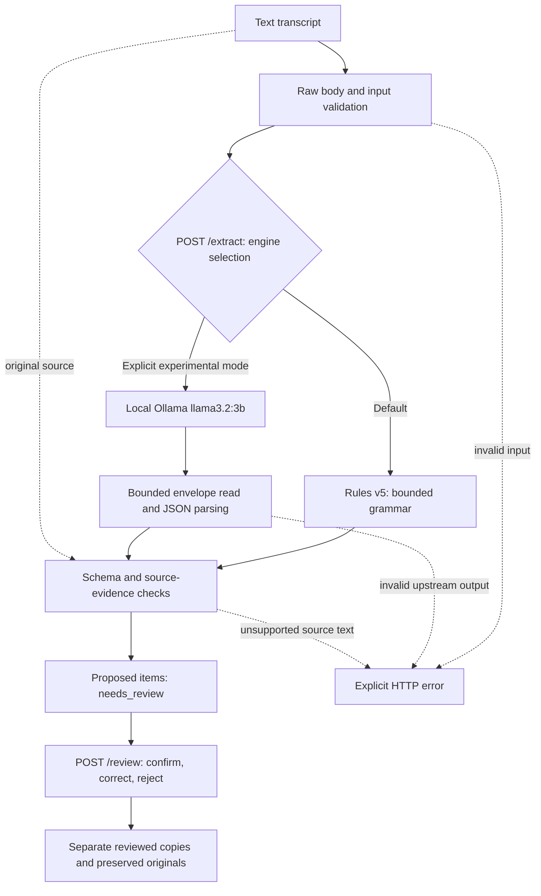
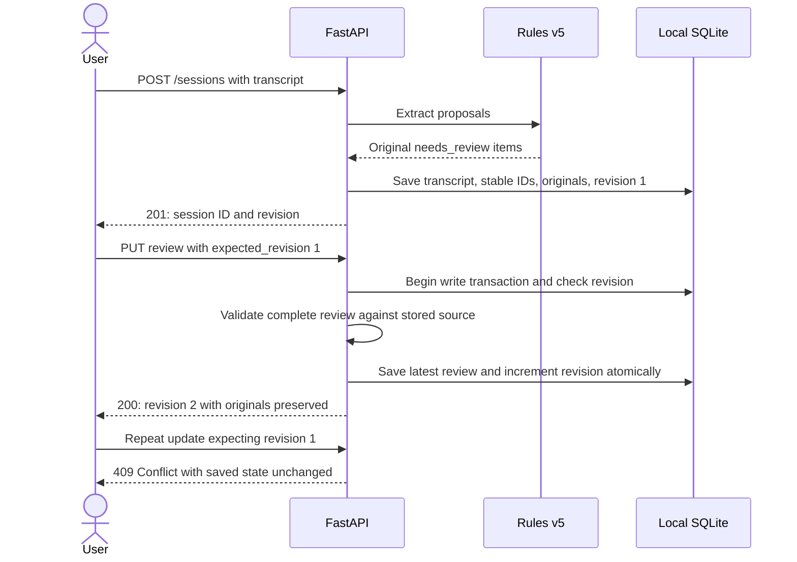
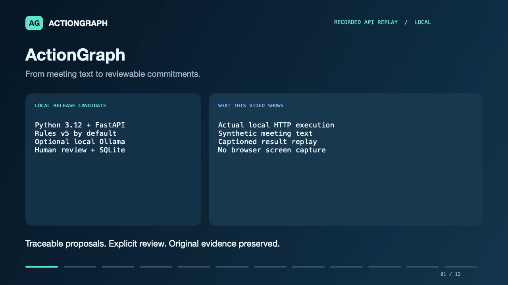

# ActionGraph

**Turn supported meeting commitments into action items you can inspect, correct, and save.**

[](https://github.com/AbhinavS-30/ActionGraph/actions/workflows/tests.yml)

[Release candidate v0.1.0-rc.1](https://github.com/AbhinavS-30/ActionGraph/tree/v0.1.0-rc.1) · [Engineering walkthrough](docs/WALKTHROUGH.md) · [Evaluation evidence](#evaluation) · [Recording guide](docs/RECORDING.md)

ActionGraph is a local FastAPI application that proposes structured action items
from text transcripts, attaches exact source evidence, and supports explicit
human review. Optional SQLite sessions preserve original proposals alongside the
latest reviewed results, with revision checks to prevent stale updates.

**Status:** verified local release candidate. Rules v5 is the default;
local Ollama `llama3.2:3b` is explicitly experimental. This is an engineering
portfolio project with measured limitations, not a production service or a claim
of general meeting-understanding accuracy. A captioned API replay is available below; a separate public project page
has not been built.

## What you can do

- Extract supported promises and adjacent accepted requests into action, owner,
  deadline, evidence, and review status.
- Inspect exact transcript quotes; preserve unknown values as genuine `null`.
- Confirm, correct, or reject proposals without overwriting the original snapshot.
- Save rules-generated sessions locally and retrieve them after restarting.
- Reject stale review updates and deletes using revision numbers.
- Compare the product engine with a preserved baseline and experimental local
  inference using reproducible synthetic evaluation artifacts.

The initial interface is **Swagger UI**. Default rules mode needs no model
service, paid API, or cloud inference.

## Architecture

Extraction keeps generation, validation, and review as separate responsibilities:



Persistence is an explicit, separate **rules-only** workflow. Stateless extraction
and review do not automatically save data:



A matching quote establishes **text presence**, not correct interpretation.
A confirmed item records the caller's decision, not proof of correctness or
completion of the work. See [review policy](docs/REVIEW.md).

## Quick start

Requirements: **Python 3.12** and Git. Run these commands in a terminal:

```bash
git clone https://github.com/AbhinavS-30/ActionGraph.git
cd ActionGraph
python3.12 -m venv .venv
.venv/bin/python -m pip install -r requirements.lock.txt
.venv/bin/python -m uvicorn app.main:app --reload
```

Open **[http://127.0.0.1:8000/docs](http://127.0.0.1:8000/docs)**. Expand
`POST /extract`, select **Try it out**, enter a transcript, and click **Execute**.
Keep the server on loopback with one worker. Use synthetic/public text only.
Swagger loads its UI assets from its configured CDN.

```bash
curl -X POST http://127.0.0.1:8000/extract \
  -H 'Content-Type: application/json' \
  -d '{"transcript":"Maya: I will review the report tomorrow."}'
```

The response contains `items`, `engine`, and `limitations`. The illustrative item
below shows the inner item contract:

```json
{
  "action": "Review the report",
  "owner": "Maya",
  "deadline": "tomorrow",
  "evidence": "Maya: I will review the report tomorrow.",
  "review_status": "needs_review"
}
```

Unknown owners/deadlines use JSON `null`, never the string `"null"`. Blank fields
and unexpected action-item fields are rejected. Relative dates remain exactly
stated; calendar-date conversion is not implemented. Review every returned item
and inspect the transcript for omissions.

### Optional saved sessions

Stop the server, choose an absolute database path in an existing writable
directory, then export it and restart. For a disposable demonstration:

```bash
actiongraph_demo_dir=$(mktemp -d /tmp/actiongraph-demo.XXXXXX)
export ACTIONGRAPH_DB_PATH="$actiongraph_demo_dir/sessions.sqlite3"
.venv/bin/python -m uvicorn app.main:app --reload
```

1. `POST /sessions` with the transcript above. Copy the returned session `id`.
2. `PUT /sessions/{id}/review` with:

   ```json
   {
     "expected_revision": 1,
     "decisions": [{"proposal_index": 0, "decision": "confirm"}]
   }
   ```

3. `GET /sessions/{id}` returns revision 2, original `needs_review` proposals,
   and a separate confirmed entry in `latest_review`.
4. Reusing revision 1 returns **409**. Restarting with the same database retains
   the saved state. Deletion requires the current revision.

Storage is disabled unless `ACTIONGRAPH_DB_PATH` is set. It retains originals
and the **latest** review, not full review history. No authentication, listing,
automatic backup, or TTL is provided. Database files are ignored by Git.
Read the [storage and deletion policy](docs/STORAGE.md) before using persistence.

### Experimental local inference

With local Ollama running and `llama3.2:3b` already installed, explicitly send:

```json
{"transcript":"Maya: I will review the report tomorrow.","engine":"ollama"}
```

The application does not download models. Experimental inference failures remain
failures; there is no silent fallback to rules. Saved-session creation is rules-only.

## API reference

| Endpoint | Purpose | Success |
| --- | --- | --- |
| `GET /health` | Application capabilities; not model readiness | 200 |
| `POST /extract` | Propose items without saving | 200 |
| `POST /review` | Review caller-supplied proposals without saving | 200 |
| `POST /sessions` | Extract and explicitly save a rules session | 201 |
| `GET /sessions/{id}` | Retrieve originals, metadata, and latest review | 200 |
| `PUT /sessions/{id}/review` | Save a complete revision-checked review | 200 |
| `DELETE /sessions/{id}?expected_revision=N` | Delete the session and latest review | 204 |

| Error | Meaning |
| --- | --- |
| 413 | Raw HTTP body exceeds 2 MiB |
| 422 | Invalid input, incomplete review, or unsupported correction |
| 404 | Saved session missing or deleted |
| 409 | Expected revision is stale; reload before changing data |
| 502 | Experimental upstream/output failure; no partial items returned |
| 503 | Model/storage unavailable, disabled, or busy |
| 504 | Ollama network operation timed out |
| 500 | Sanitized local storage failure |

## Engineering decisions

| Decision | Why it matters |
| --- | --- |
| Rules default; model explicitly experimental | Evaluation found the local model less reliable than the baseline on the recorded validation run. The product scope follows the evidence. |
| Exact quotes and nullable unknowns | Callers can inspect the source instead of receiving guessed fields without traceability. |
| Originals separate from reviewed copies | Human changes remain visible without rewriting what extraction proposed. |
| Atomic SQLite writes and revision checks | Invalid batches roll back; stale requests cannot overwrite newer saved reviews. |
| Bounded request and generation buffering | Reject oversized input/output explicitly before unbounded application buffering. |
| Preserved failed experiments and first-run results | Later tuning does not replace the original evidence or become independent validation. |

## Evaluation

The datasets are synthetic, and semantic scoring is **provisional Codex review**.
Independent human adjudication and real-meeting accuracy are not established.
A true positive (TP) is a matched task; a false positive (FP) is an extra task;
a false negative (FN) is a missed labeled task.

| Recorded run | TP / FP / FN | Interpretation |
| --- | --- | --- |
| [First model validation](evals/results/REPORT-validation-d21e6b6.md) | 2 / 2 / 6 | Only 5/10 calls succeeded; the simple baseline exceeded the model. |
| [First frozen-v4 rules validation](evals/results/REPORT-rules-v4-fresh-486fcb5.md) | 6 / 1 / 5 | 14 cases, 11 labeled tasks; a withdrawn promise was returned. Labels fixed before extraction, author knew the implementation. |
| [Rules v5 replay on that observed set](evals/results/REPORT-rules-v5-fa37f4e.md) | 6 / 0 / 5 | Targeted withdrawal fix; five misses remain. This is development regression evidence, not a fresh validation result. |

Raw attempts, dataset hashes, source revisions, pairings, and timing limitations
are preserved in [evals/results](evals/results). Run collection from a Git checkout;
see the [evaluation guide](evals/README.md). Do not interpret successful schema or
quote checks as semantic accuracy, or these small runs as general performance.

## Verification

```bash
.venv/bin/python -m pytest
.venv/bin/python -m ruff check app tests evals
```

**346 tests and Ruff pass** at the verified implementation checkpoint. GitHub CI
runs Python 3.12 tests and Ruff without downloading or running Ollama. Candidate
verification also covers a separate pinned environment, extracted-package tests,
real HTTP persistence/restart/conflict/deletion checks, and user-assisted Swagger
screenshots. See the [candidate verification record](docs/verification/CANDIDATE-70cf9d4.md)
and [completed browser checklist](docs/SWAGGER_CHECK.md). Tests verify implementation
behavior; they are not extraction-quality measurements.

## Limits and scope

- The fixed grammar can miss ownerless work, unsupported verbs/times, object lists,
  shared deadlines, and broader dialogue. Empty output does not mean no work exists.
- Unsupported withdrawals can leave unwanted proposals. Human review can correct
  or reject proposals, but cannot currently add a missed task.
- Input: 12,000 transcript characters and 2 MiB raw HTTP body. Ollama generation
  envelope: 1 MiB, identity encoding only. Oversized envelopes fail with 502.
- Model timeout is per network operation; there is no hard total-duration limit.
  API output-byte, disk quota, and distributed concurrency limits are not established.
- This is a loopback-only tool with no authentication or public inference deployment.
  Saved-session IDs are not authorization; deletion is not secure filesystem erasure.
- Audio, calendar integration, elaborate dashboards, and cross-meeting memory
  are outside this release scope.

Exact policies: [rules](docs/RULES.md) · [review](docs/REVIEW.md) ·
[storage](docs/STORAGE.md) · [resource limits](docs/LIMITS.md).

## Demo and project guide

The [mixed-case walkthrough](docs/WALKTHROUGH.md) explains data flow and code
syntax and includes a rehearsed success/failure example.

[](docs/media/actiongraph-demo.mp4)

**[Watch/download the 2:03 demo](https://raw.githubusercontent.com/AbhinavS-30/ActionGraph/main/docs/media/actiongraph-demo.mp4)** — silent, captioned replay of real local API calls using synthetic data.
This is a rendered API replay, not a Swagger screen recording.
[Execution evidence and video details](docs/media/README.md) ·
[Optional narration](docs/DEMO_NARRATION.md).
The [recording storyboard](docs/RECORDING.md) also supports a future browser recording.

| Location | Contents |
| --- | --- |
| `app/` | API, contracts, engines, source checks, review, and storage |
| `tests/` | Automated behavior and failure-path checks |
| `data/synthetic/` | Publicly shareable demonstration transcripts |
| `evals/` | Labels, preserved baseline, collection tooling, and results |
| [Status](docs/STATUS.md) | Current capabilities, evidence, and remaining delivery work |
| [Release candidate](docs/RELEASE_CANDIDATE.md) | Verified scope and limitations |
| [Release notes](docs/RELEASE_NOTES.md) | Draft stable-release notes and candidate provenance |
| [Validation design](docs/VALIDATION.md) | Contracts and failure behavior |
| [Roadmap](docs/ROADMAP.md) | Delivery scope and next steps |

Keep secrets, private transcripts, virtual environments, model weights, and local
databases out of version control. No LinkedIn post is published automatically.
