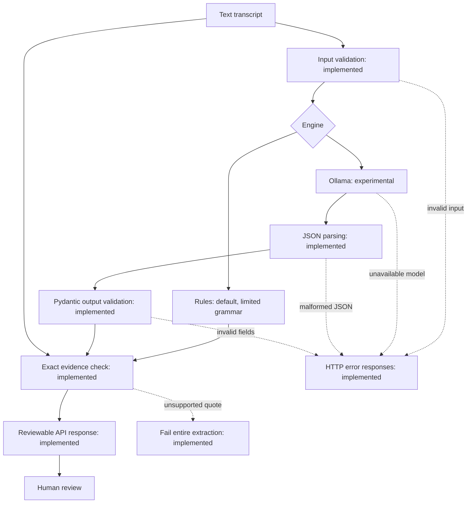

# ActionGraph

Evidence-backed action items from meeting transcripts, designed for local inference and human review.

ActionGraph aims to turn meeting discussion into a structured list of commitments: what needs to happen, who owns it, when it is due, and the exact words supporting it. Unknown owners and deadlines remain explicit rather than being guessed.

**Development status:** the local API defaults to an explicitly limited rule-based demo engine; experimental local Ollama extraction remains opt-in. Responses identify the engine and scope limits. Tests, source-evidence checks, CI, and synthetic evaluations are implemented. Broad meeting understanding and production readiness are not claimed.

## Intended application

The local API accepts a text transcript and returns proposed action items for review. FastAPI's interactive API page provides the initial submission interface. Each item will include an action, nullable owner and deadline, supporting evidence, and review status. A custom dashboard is outside the initial scope.

## Architecture

The API selects rules by default or experimental local inference explicitly, then returns proposed items for review. Human confirmation and persistence remain planned.



| Step | Purpose and design choice |
| --- | --- |
| Input validation | Reject non-string and blank input before further processing. Trim outside whitespace while retaining internal text. |
| Local inference | A standalone client requests text from local Ollama with `llama3.2:3b`. Extraction rules and a prompt builder exist; one structured-output smoke example passed; a first development comparison found semantic errors; see the evaluation report. |
| JSON parsing | Convert response text into Python data. Reject malformed JSON rather than silently repairing it. |
| Output validation | Require a consistent structure and field types so downstream code can work with predictable data. |
| Evidence matching | Check quote presence against the original transcript. Preserve spelling, case, spacing, and punctuation. Reject blank evidence as a match. |
| Human review | Keep interpretation open to correction: an exact quote can still be assigned to the wrong action, owner, or deadline. |

## Output contract

An illustrative result follows. It demonstrates the contract, not a measured evaluation result.

```json
{
  "items": [
    {
      "action": "Send the API specification",
      "owner": "Maya",
      "deadline": "Friday",
      "evidence": "Maya: I will send the API specification by Friday.",
      "review_status": "needs_review"
    }
  ]
}
```

| Field | Meaning and current rules |
| --- | --- |
| `items` | Required list of action items; an empty list is allowed. |
| `action` | Required string with at least one character describing the work. |
| `owner` | Required field containing a string or `null` when unknown. |
| `deadline` | Required field containing a string or `null` when unspecified. Date normalization is not implemented. |
| `evidence` | Required string with at least one character. The separate evidence helper rejects whitespace-only quotes and checks exact presence. |
| `review_status` | `needs_review` by default, or `confirmed`. A confirmation workflow is not implemented. |

Unexpected fields within an action item are rejected. Owner and deadline reject the string placeholder `"null"` (including case and surrounding-whitespace variants); unknown values must use JSON `null`. Current minimum-length schema checks do not reject every whitespace-only field. Schema validity does not establish extraction correctness, and the parser does not invoke evidence checks automatically. The connected extraction function additionally requires non-null owner/deadline text to occur verbatim at word boundaries in item evidence. This rejects absent or partial-name values but does not prove correct attribution.

## Available components

| Component | Location | Current behavior |
| --- | --- | --- |
| HTTP health endpoint | `app/main.py` | `GET /health` reports the function and extraction API as available; this is not a model readiness check. |
| Transcript validator | `app/validation.py` | Returns trimmed text; raises `TypeError` for non-string input and `ValueError` for blank input. |
| Output models | `app/schemas.py` | Defines `ActionItem` and the enclosing `ExtractionResult`. |
| Response parser | `app/parsing.py` | Parses JSON, then validates the output contract. Malformed text raises `JSONDecodeError`; schema mismatches raise `ValidationError`. |
| Ollama text client | `app/ollama.py` | Sends nonstreaming generation requests with an optional JSON schema; returns response text and preserves connection, timeout, and HTTP failures. Rejects invalid response envelopes. |
| Extraction function | `app/extraction.py` | Connects prompt, model, parser, and evidence checks; fails the entire result on unsupported evidence and returns items as `needs_review`. |
| Evidence checker | `app/evidence.py` | Returns a boolean for exact quote presence. Invalid input types and invalid transcripts raise errors. |

## Run locally

Prerequisite: Python 3.12. Default rules mode does not need Ollama. Run commands from the repository root.

For a new checkout, create an isolated Python environment and install pinned dependencies:

```bash
python3.12 -m venv .venv
.venv/bin/python -m pip install -r requirements.lock.txt
```

Run the current API:

```bash
.venv/bin/python -m uvicorn app.main:app --reload
```

Open the [interactive API documentation](http://127.0.0.1:8000/docs). Expand `POST /extract`, select **Try it out**, enter a transcript request, and execute.

```bash
curl http://127.0.0.1:8000/health
```

Expected response:

```json
{"status": "ok", "extraction": "function_available", "extraction_api": "available", "default_engine": "rules"}
```

Unit tests use simulated HTTP responses and do not require Ollama. Calling the standalone model client requires a running local Ollama service and the installed `llama3.2:3b` model. The caller supplies an HTTPX client. The API loads validated exported settings at startup, defaults to local Ollama, and uses a 60-second HTTPX timeout for network operations. This is not a total generation deadline. No paid inference API is required by the planned architecture.

## Verification

```bash
.venv/bin/python -m pytest
.venv/bin/python -m ruff check app tests
```

The current suite contains 192 passing test cases covering the health response, output contract, transcript validation, JSON parsing, exact evidence matching, and Ollama client failure handling. This is a correctness check of these components, not a measurement of model accuracy.

GitHub Actions runs Python 3.12 tests and Ruff on pushes and pull requests.
The workflow also lints `evals/` and has a ten-minute job timeout. These automated
checks use simulated model responses; they do not download or run Ollama.

## Delivery phases

| Phase | Status | Deliverable and completion criteria |
| --- | --- | --- |
| 1. Validation foundation | Implemented as standalone components | Validated input, structured output contract, response parser, evidence helper, and focused tests. |
| 2. Local model integration | In progress: standalone text client implemented | Ollama request handling, extraction instructions, structured response handling, timeouts, and model-unavailability tests. |
| 3. Connected extraction service | Python function implemented; first development comparison available | Connect the components; enforce the agreed ambiguous commitment, relative-date, and unsupported-evidence policies; preserve review needs without inventing values. |
| 4. Usable MVP | Endpoint and failure responses implemented; demo verification in progress | Extraction endpoint, documented request/response examples, and actionable error responses through the local API interface. |
| 5. Evaluation and demonstration | First development comparison recorded; human adjudication pending | Labeled synthetic transcripts, a documented matching rubric, measured errors and latency, reproducible demo, and disclosed limitations. |

The initial demo target is November 3, 2026. It is a delivery target, not a claim of completion.

## Terminology

| Term | Meaning in ActionGraph |
| --- | --- |
| Transcript | Text recording who said what during a meeting. |
| Action item | Proposed work supported by a commitment in the discussion. |
| Dependency | Something that must happen first; it does not necessarily establish a deadline. |
| JSON | A text format for objects, lists, strings, numbers, and values such as `null`. |
| Parsing | Converting JSON text into Python values; JSON `null` becomes Python `None`. |
| Schema | The contract defining required fields, allowed types, and constraints. |
| Validation | Checking input or output against explicit rules. |
| Evidence | An exact excerpt supporting a proposed item. |
| Inference | Running a model to generate a proposed result from input. |
| API / endpoint | A program interface / a particular route that accepts requests or returns responses. |
| FastAPI / Uvicorn | The Python API framework / the server that runs it locally. |
| Pydantic | The library enforcing the structured output contract. |
| pytest / Ruff | Tools for automated tests / Python code checks and formatting. |
| Ollama | The planned local model runtime; `llama3.2:3b` is the selected model. |
| Precision / recall | Planned evaluation measures: how many proposed items are correct / how many labeled items were found. Both require a defined matching rubric. |
| Latency | Measured time to produce a result; first-run timings are in the evaluation report. |

## Scope and limitations

- Use synthetic or public transcripts only. The supplied example is in `data/synthetic/meeting-01.txt`.
- A reusable extraction function connects model generation, parsing, and evidence checks; the local extraction endpoint is available; review persistence is not implemented.
- A [first development comparison](evals/results/REPORT-8dc8253.md) records provisional task scores and measured durations. It is one ten-case synthetic run reviewed by Codex, not a real-world accuracy claim.
- Exact evidence matching proves quote presence, not interpretation, attribution, or completeness.
- The initial policy excludes ambiguous commitments and unanswered requests and preserves relative deadline wording; date conversion is deferred. See [validation design](docs/VALIDATION.md).
- Audio transcription, calendar integrations, cross-meeting memory, and elaborate dashboards are deferred.
- Keep secrets, virtual environments, model weights, and private data out of version control.

## Repository guide

- `app/`: API and processing components.
- `tests/`: automated behavior checks.
- `data/synthetic/`: example input transcripts.
- `evals/`: ten labeled synthetic development cases and a [matching rubric](evals/README.md); collector and deterministic baseline available; first raw comparison and provisional semantic review available in `evals/results/`.
- [Project status](docs/STATUS.md): implemented capabilities, checks, and current limitations.
- [Roadmap](docs/ROADMAP.md): delivery phases and acceptance criteria.
- [Validation design](docs/VALIDATION.md): component responsibilities and failure behavior.
- [Local demo](docs/DEMO.md): presentation sequence, observed TCP smoke check, and user-verified browser success/rejection paths.

## Extraction request and failures

Start Uvicorn using the command above. Rules mode needs no model service. To opt into experimental inference, start Ollama with `llama3.2:3b` installed and send `"engine": "ollama"`. No model downloads are performed by this application. Defaults are `http://127.0.0.1:11434` and `llama3.2:3b`. Exported environment overrides are supported; `.env` files are not read automatically. Restart the API after changing settings.

```bash
curl -X POST http://127.0.0.1:8000/extract \
  -H 'Content-Type: application/json' \
  -d '{"transcript":"Maya: I will send the report tomorrow."}'
```

The response uses the `items` contract above; model output can vary, and every item requires review. Unknown values remain null. Unsupported evidence fails the whole extraction.

| HTTP status | Meaning and next action |
| --- | --- |
| 200 | Proposed items returned; inspect them for correctness and omissions. |
| 422 | Missing, non-string, blank, or over-12,000-character transcript, malformed request JSON, or extra request fields; correct the request. |
| 503 | Ollama unreachable, model unavailable, or another extraction running; inspect the detail and retry as directed. |
| 504 | Ollama timed out; retry with a shorter transcript. |
| 502 | Upstream HTTP failure, invalid output, unsupported evidence, or owner/deadline text absent from evidence; inspect input and Ollama, then retry and review. |

There are no automatic retries, saved results, authentication, or human confirmation endpoint. Run this initial API locally.

## Local runtime configuration

| Exported variable | Default | Validation |
| --- | --- | --- |
| `OLLAMA_BASE_URL` | `http://127.0.0.1:11434` | HTTP loopback origin only; no credentials, path, query, or fragment |
| `OLLAMA_MODEL` | `llama3.2:3b` | Nonblank installed model name; no automatic downloads |
| `OLLAMA_TIMEOUT_SECONDS` | `60` | Greater than zero, at most 120 seconds per network operation |
| `OLLAMA_NUM_PREDICT` | `1024` | Integer from 1 through 4096; maximum generated tokens |

Example: `export OLLAMA_TIMEOUT_SECONDS=30` before launching Uvicorn. Invalid
settings prevent application startup. Settings are cached until restart; proxy
environment variables are ignored for local Ollama requests. No new dependencies
were added.

Transcripts are limited to 12,000 Python characters before trimming; the original
text is preserved for evidence checks. This is not a raw HTTP body-size limit or
a concurrency limit. Generation requests include `options.num_predict`. A response
with `done_reason=length` is rejected as incomplete even if its text happens to
parse. Raising a token limit does not guarantee complete or correct extraction.
The new generation limit changes runtime settings; earlier reports retain the
settings actually used in their recorded source revisions.

## Local concurrency behavior

Run one Uvicorn worker for the demo (the documented command does this). Each API
process admits one extraction at a time. An overlapping valid request receives
HTTP 503 with `Retry-After: 1` and no model invocation; the client should retry
after the active extraction finishes. No request queue or automatic retry exists.
The slot is released on success and failure; health requests remain available.
This process-local guard does not coordinate multiple workers, the evaluation
runner, or other applications using Ollama. It is not a distributed rate limiter
or a complete public-service overload control.

The [strict-contract comparison](evals/results/REPORT-b7bf4c4.md) completed only
4/10 model calls successfully: six outputs were rejected for string-null fields.
Its 100% delivered task precision must be read alongside 62.5% task recall and
that failure rate. Validation prevents invalid delivery; it does not establish
reliable extraction. These remain provisional Codex-reviewed development results.

A [JSON-null prompt experiment](evals/results/REPORT-fcc91ec.md) reduced some
validation failures in one run but worsened delivered task scores and leaked a
prompt example. That prompt candidate was not adopted; the preceding prompt was
restored. Failed experiments remain available for inspection.

The [first fresh-set validation](evals/results/REPORT-validation-d21e6b6.md)
completed 5/10 model calls and delivered two correct task matches, two extra tasks,
and six missed labels. The baseline outperformed the model in that run. This
project currently demonstrates a local extraction system and transparent
evaluation; it is not a production-ready commitment extractor.

## Default demo engine

`POST /extract` now defaults to `engine: rules`. Successful responses contain
`items`, `engine`, and `limitations`. The rules support a narrow first-person
commitment grammar and stated date forms; see [exact scope and API migration](docs/RULES.md).
Unsupported forms may be missed, including accepted requests and ownerless work.
An empty result is not a completeness claim. This mode is separate from the
unchanged evaluation baseline. No model call or automatic fallback occurs.

Use `engine: ollama` explicitly for the experimental model path. Earlier model
reports describe their recorded revisions and do not measure this new rules mode.

The [rules v1 known-case report](evals/results/REPORT-rules-45bdcb3.md) records
six fully correct items out of eight labels on each known synthetic set, no extra
tasks, and explicit misses for accepted requests and ownerless work. These sets
were inspected during development; these are not held-out accuracy estimates.

The [first rules-focused validation](evals/results/REPORT-rules-validation-042cf19.md)
returned 4 correct tasks, 1 cancelled-task false positive and 5 misses across
nine labeled tasks in twelve new synthetic cases. This exposes the cross-line
cancellation limit and prevents interpreting the earlier known-case results as
general accuracy. See the report for denominators and provisional review notes.

Rules v2 additionally applies [explicit cancellation matching](docs/RULES.md)
for later same-speaker negations of the same task. This is not general dialogue
understanding; historical v1 reports remain unchanged. The recorded demo and
public page are deferred until the remaining product-release gates are complete.
