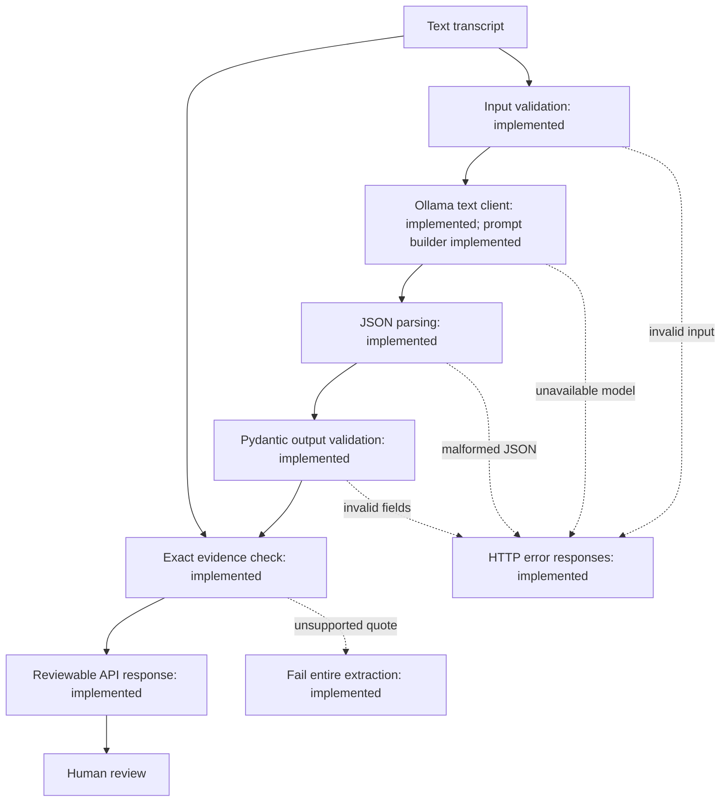

# ActionGraph

Evidence-backed action items from meeting transcripts, designed for local inference and human review.

ActionGraph aims to turn meeting discussion into a structured list of commitments: what needs to happen, who owns it, when it is due, and the exact words supporting it. Unknown owners and deadlines remain explicit rather than being guessed.

**Development status:** input validation, JSON parsing, output schemas, exact evidence matching, a health endpoint, a standalone Ollama text client, and an extraction prompt builder are implemented. A reusable Python extraction function connects these components. The local extraction API is implemented; quality evaluation remains pending.

## Intended application

The local API accepts a text transcript and returns proposed action items for review. FastAPI's interactive API page provides the initial submission interface. Each item will include an action, nullable owner and deadline, supporting evidence, and review status. A custom dashboard is outside the initial scope.

## Architecture

The diagram describes the target flow. The Python extraction function connects input validation through evidence checks. The API returns proposed items; human confirmation and persistence remain planned.



| Step | Purpose and design choice |
| --- | --- |
| Input validation | Reject non-string and blank input before further processing. Trim outside whitespace while retaining internal text. |
| Local inference | A standalone client requests text from local Ollama with `llama3.2:3b`. Extraction rules and a prompt builder exist; one structured-output smoke example passed; broader adherence remains unevaluated. |
| JSON parsing | Convert response text into Python data. Reject malformed JSON rather than silently repairing it. |
| Output validation | Require a consistent structure and field types so downstream code can work with predictable data. |
| Evidence matching | Check quote presence against the original transcript. Preserve spelling, case, spacing, and punctuation. Reject blank evidence as a match. |
| Human review | Keep interpretation open to correction: an exact quote can still be assigned to the wrong action, owner, or deadline. |

## Output contract

An illustrative result follows. It demonstrates the contract, not a measured evaluation result.

```json
{
  "items": [
    {
      "action": "Send the API specification",
      "owner": "Maya",
      "deadline": "Friday",
      "evidence": "Maya: I will send the API specification by Friday.",
      "review_status": "needs_review"
    }
  ]
}
```

| Field | Meaning and current rules |
| --- | --- |
| `items` | Required list of action items; an empty list is allowed. |
| `action` | Required string with at least one character describing the work. |
| `owner` | Required field containing a string or `null` when unknown. |
| `deadline` | Required field containing a string or `null` when unspecified. Date normalization is not implemented. |
| `evidence` | Required string with at least one character. The separate evidence helper rejects whitespace-only quotes and checks exact presence. |
| `review_status` | `needs_review` by default, or `confirmed`. A confirmation workflow is not implemented. |

Unexpected fields within an action item are rejected. Current minimum-length schema checks do not reject every whitespace-only field. Schema validity does not establish extraction correctness, and the parser does not invoke the evidence checker automatically.

## Available components

| Component | Location | Current behavior |
| --- | --- | --- |
| HTTP health endpoint | `app/main.py` | `GET /health` reports the function and extraction API as available; this is not a model readiness check. |
| Transcript validator | `app/validation.py` | Returns trimmed text; raises `TypeError` for non-string input and `ValueError` for blank input. |
| Output models | `app/schemas.py` | Defines `ActionItem` and the enclosing `ExtractionResult`. |
| Response parser | `app/parsing.py` | Parses JSON, then validates the output contract. Malformed text raises `JSONDecodeError`; schema mismatches raise `ValidationError`. |
| Ollama text client | `app/ollama.py` | Sends nonstreaming generation requests with an optional JSON schema; returns response text and preserves connection, timeout, and HTTP failures. Rejects invalid response envelopes. |
| Extraction function | `app/extraction.py` | Connects prompt, model, parser, and evidence checks; fails the entire result on unsupported evidence and returns items as `needs_review`. |
| Evidence checker | `app/evidence.py` | Returns a boolean for exact quote presence. Invalid input types and invalid transcripts raise errors. |

## Run locally

Prerequisite: Python 3.12. Run commands from the repository root.

For a new checkout, create an isolated Python environment and install pinned dependencies:

```bash
python3.12 -m venv .venv
.venv/bin/python -m pip install -r requirements.lock.txt
```

Run the current API:

```bash
.venv/bin/python -m uvicorn app.main:app --reload
```

Open the [interactive API documentation](http://127.0.0.1:8000/docs). Expand `POST /extract`, select **Try it out**, enter a transcript request, and execute.

```bash
curl http://127.0.0.1:8000/health
```

Expected response:

```json
{"status": "ok", "extraction": "function_available", "extraction_api": "available"}
```

Unit tests use simulated HTTP responses and do not require Ollama. Calling the standalone model client requires a running local Ollama service and the installed `llama3.2:3b` model. The caller supplies an HTTPX client with a base URL and explicit timeout; environment variables are not loaded automatically. The API uses the local address and a 60-second HTTPX timeout for network operations. This is not a total generation deadline. No paid inference API is required by the planned architecture.

## Verification

```bash
.venv/bin/python -m pytest
.venv/bin/python -m ruff check app tests
```

The current suite contains 86 passing test cases covering the health response, output contract, transcript validation, JSON parsing, exact evidence matching, and Ollama client failure handling. This is a correctness check of these components, not a measurement of model accuracy.

## Delivery phases

| Phase | Status | Deliverable and completion criteria |
| --- | --- | --- |
| 1. Validation foundation | Implemented as standalone components | Validated input, structured output contract, response parser, evidence helper, and focused tests. |
| 2. Local model integration | In progress: standalone text client implemented | Ollama request handling, extraction instructions, structured response handling, timeouts, and model-unavailability tests. |
| 3. Connected extraction service | Python function implemented; semantics unevaluated | Connect the components; enforce the agreed ambiguous commitment, relative-date, and unsupported-evidence policies; preserve review needs without inventing values. |
| 4. Usable MVP | Endpoint and failure responses implemented; demo verification in progress | Extraction endpoint, documented request/response examples, and actionable error responses through the local API interface. |
| 5. Evaluation and demonstration | Planned | Labeled synthetic transcripts, a documented matching rubric, measured errors and latency, reproducible demo, and disclosed limitations. |

The initial demo target is November 3, 2026. It is a delivery target, not a claim of completion.

## Terminology

| Term | Meaning in ActionGraph |
| --- | --- |
| Transcript | Text recording who said what during a meeting. |
| Action item | Proposed work supported by a commitment in the discussion. |
| Dependency | Something that must happen first; it does not necessarily establish a deadline. |
| JSON | A text format for objects, lists, strings, numbers, and values such as `null`. |
| Parsing | Converting JSON text into Python values; JSON `null` becomes Python `None`. |
| Schema | The contract defining required fields, allowed types, and constraints. |
| Validation | Checking input or output against explicit rules. |
| Evidence | An exact excerpt supporting a proposed item. |
| Inference | Running a model to generate a proposed result from input. |
| API / endpoint | A program interface / a particular route that accepts requests or returns responses. |
| FastAPI / Uvicorn | The Python API framework / the server that runs it locally. |
| Pydantic | The library enforcing the structured output contract. |
| pytest / Ruff | Tools for automated tests / Python code checks and formatting. |
| Ollama | The planned local model runtime; `llama3.2:3b` is the selected model. |
| Precision / recall | Planned evaluation measures: how many proposed items are correct / how many labeled items were found. Both require a defined matching rubric. |
| Latency | Measured time to produce a result; no extraction latency has been measured yet. |

## Scope and limitations

- Use synthetic or public transcripts only. The supplied example is in `data/synthetic/meeting-01.txt`.
- A reusable extraction function connects model generation, parsing, and evidence checks; the local extraction endpoint is available; review persistence is not implemented.
- No extraction precision, recall, or latency results are available.
- Exact evidence matching proves quote presence, not interpretation, attribution, or completeness.
- The initial policy excludes ambiguous commitments and unanswered requests and preserves relative deadline wording; date conversion is deferred. See [validation design](docs/VALIDATION.md).
- Audio transcription, calendar integrations, cross-meeting memory, and elaborate dashboards are deferred.
- Keep secrets, virtual environments, model weights, and private data out of version control.

## Repository guide

- `app/`: API and processing components.
- `tests/`: automated behavior checks.
- `data/synthetic/`: example input transcripts.
- `evals/`: reserved for evaluation artifacts; evaluation is not implemented.
- [Project status](docs/STATUS.md): implemented capabilities, checks, and current limitations.
- [Roadmap](docs/ROADMAP.md): delivery phases and acceptance criteria.
- [Validation design](docs/VALIDATION.md): component responsibilities and failure behavior.

## Extraction request and failures

Ensure the Ollama service is running with `llama3.2:3b` installed, then start Uvicorn using the command above. No model downloads are performed by this application. The API currently uses `http://127.0.0.1:11434` and `llama3.2:3b`; `.env.example` documents the intended configuration, but environment overrides are not yet implemented.

```bash
curl -X POST http://127.0.0.1:8000/extract \
  -H 'Content-Type: application/json' \
  -d '{"transcript":"Maya: I will send the report tomorrow."}'
```

The response uses the `items` contract above; model output can vary, and every item requires review. Unknown values remain null. Unsupported evidence fails the whole extraction.

| HTTP status | Meaning and next action |
| --- | --- |
| 200 | Proposed items returned; inspect them for correctness and omissions. |
| 422 | Missing, non-string, or blank transcript, malformed request JSON, or extra request fields; correct the request. |
| 503 | Ollama unreachable or model unavailable; start the service or check the installed model. |
| 504 | Ollama timed out; retry with a shorter transcript. |
| 502 | Upstream HTTP failure, invalid output, or unsupported evidence; inspect input and Ollama, then retry and review. |

There are no automatic retries, saved results, authentication, or human confirmation endpoint. Run this initial API locally.
