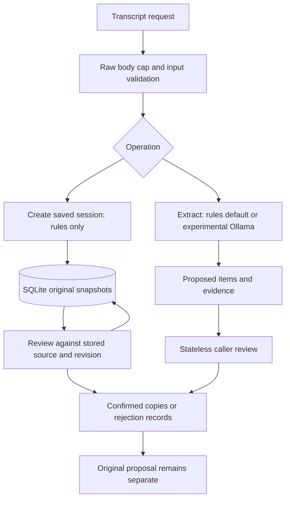

# ActionGraph engineering walkthrough

Application checkpoint 351b3a0; candidate tag v0.1.0-rc.1 at 70cf9d4.
This document explains the implemented product. It is not personal learning
history, new accuracy evidence or a claim of general production readiness.

## Purpose and current scope

Meeting discussion contains requests, suggestions, promises, refusals and later
changes. ActionGraph proposes structured tasks from supported forms, attaches
exact source evidence, and lets a caller review the proposals. The local API
is the product interface; Swagger is its interactive client. Optional SQLite
sessions retain reviewed results across restart. Only synthetic/public input is
within the project's current data policy.

The two extraction engines have different behavior. Rules v5 is default and uses
fixed patterns without inference. Ollama llama3.2:3b is explicit experimental mode;
it uses local inference and has observed reliability failures. The rules pivot
followed evaluations in which the model underperformed a simple baseline. A
validated JSON response did not fix semantic mistakes. There is no automatic
fallback that disguises a model failure as rules output.

## Data flow

POST /extract validates input, selects the engine and returns proposed items,
engine label and limitations. It never saves. POST /sessions instead runs rules
and explicitly stores the resulting transcript/proposals with IDs and revision 1.
POST /review reviews caller-supplied proposals without storage. Saved review uses
PUT /sessions/{id}/review and validates against server-stored originals. This
keeps stateless caller snapshots distinct from saved extraction provenance.

## Fields and what they guarantee

| Field | Meaning |
| --- | --- |
| action | Work description; may be human-corrected, never blank. |
| owner | Named owner or genuine JSON null. A recipient is not automatically the owner. |
| deadline | Stated wording or null. Tomorrow remains tomorrow; calendar conversion is not implemented. |
| evidence | Exact original substring, including source spacing/newlines. Accepted requests include both request and acceptance. |
| review_status | Extraction returns needs_review. A separate reviewed copy can become confirmed through an explicit caller decision. |

JSON null becomes Python None. The string "null" is rejected for owner/deadline.
Pydantic checks required fields, types, allowed values and nonblank strings.
Exact evidence establishes quote presence. Field-provenance checks establish
that non-null owner/deadline text appears at word boundaries in that evidence.
Neither check proves who really owns the task, deadline scope or whether it was
later cancelled. Confirmation is a caller assertion, not authenticated approval
or proof the work is complete.

## How the rules work

rules.py processes speaker-labelled lines in transcript order. A supported direct
promise starts with I will, I'll or I’ll and a verb from the finite allowlist.
_parse_work separates supported trailing dates from the action while retaining
after dependencies. A prerequisite's due date is not borrowed as the task date.
Uncertainty, unsupported timing and unresolved main-clause pronouns are skipped.

A named can/could-you request can be resolved only when the next line explicitly
accepts it with the same speaker/verb under the documented grammar. Exactly two
complete direct task clauses may be split; ambiguous final-only dates are skipped.
Same-speaker exact task negations remove matching active proposals. Rules v5 adds
one bounded adjacent withdrawal pattern with an explicit kind-to-verb mapping.
General paraphrase, discourse and real-meeting understanding are not implemented.
Read RULES.md rather than extrapolating from a successful example.

## How experimental inference works

prompts.py builds instructions plus the original transcript as a JSON string.
ollama.py sends /api/generate with stream=false in the Ollama payload: the model
returns one complete generation envelope. HTTPX transport still reads that envelope
incrementally to enforce the byte cap. This distinction matters: HTTP response
streaming for bounded buffering does not mean streaming generated tokens to users.

The generation client checks status, encoding, response size, JSON and completion
flags. extraction.py parses the generated item JSON through schemas, checks quotes
and field text, then forces needs_review. Invalid output fails the entire call;
no partial result, silent repair or rules fallback is returned. Evaluation raw
capture shares the bounded response reader. A schema request to Ollama still
requires local validation and semantic evaluation.

## Review and persistence

Every batch needs exactly one decision per zero-based proposal index. Confirm
unchanged, supply a complete replacement, or reject. Replacement evidence cannot
change. Corrected non-null owner/deadline must still occur in preserved evidence.
Unknown values can be corrected to null. Human action wording can be rephrased.
Rejection preserves the original but sets reviewed=null.

The original snapshot remains needs_review because it records what extraction
proposed. Reviewed copies record caller decisions separately. This makes a
correction visible instead of rewriting history. The saved database retains only
the original and latest review, not all review revisions. Stateless originals
are supplied by the caller and are not authenticated extraction records.

Storage uses Python sqlite3, per-operation connections and parameterized SQL.
The sessions table stores immutable proposal snapshots/IDs in a JSON payload plus
revision/update columns. The reviews table stores the latest complete review and
has a foreign key to its session with cascade deletion. No third-party database
service or ORM was added.

BEGIN IMMEDIATE obtains the write transaction before reading/checking revision.
The whole review validates and commits together, or rolls back. Two writers with
the same expected_revision cannot both update it. Revisions protect against lost
updates; they do not authenticate callers. A session at revision 2 rejects an
update/delete expecting revision 1 with 409. Logical deletion removes the session
and latest review, not backup remnants or secure filesystem traces.

## Code navigation and important syntax

| Code | Role and syntax to recognize |
| --- | --- |
| main.py | @app.post/@app.get register HTTP routes; Depends obtains configured resources; HTTPException returns deliberate API errors. |
| schemas.py | BaseModel defines contracts; Field adds constraints; Literal restricts enumerated values; str \| None allows a string or unknown. |
| validation.py, evidence.py, provenance.py | Input checks, exact quote comparison and field text checks are distinct responsibilities. |
| rules.py | re.fullmatch requires the complete supported line; casefold is used for comparison, preserving returned evidence. |
| review.py | @model_validator checks relationships across a batch; model_copy(deep=True) protects original input from mutation. |
| storage.py | with connection handles commit/rollback; finally closes it; SQL ? placeholders bind values separately from SQL text. |
| config.py | Validates exported settings; lru_cache reads them once until restart. .env is not automatically loaded. |
| body_limit.py | ASGI middleware intercepts raw bytes before route validation; accepted bytes are replayed unchanged. |
| ollama.py, extraction.py, parsing.py, prompts.py | Transport, orchestration, JSON/schema parsing and model instructions remain separate. |
| api_docs.py | Describes existing error shapes for OpenAPI; documentation does not itself change runtime behavior. |
| tests/, evals/ | Automated implementation checks and measured semantic evaluations answer different questions. |

## API and errors

| Operation | Normal result |
| --- | --- |
| GET /health | 200 application capability report, not model readiness. |
| POST /extract | 200 proposed items without saving. |
| POST /review | 200 stateless reviewed batch, persisted=false. |
| POST /sessions | 201 saved rules session, revision=1, persisted=true. |
| GET /sessions/{id} | 200 saved originals and latest review. |
| PUT /sessions/{id}/review | 200 reviewed saved session and incremented revision. |
| DELETE /sessions/{id} | 204, no body. |

413 means raw HTTP body too large. 422 means invalid input/batch. 404 means saved
session missing. 409 means stale revision. 502 means experimental upstream/output
failure. 503 means model/storage unavailable or busy. 504 means model network
operation timeout. Storage failures can return sanitized 500. Health and default
rules need no running model service. LIMITS.md lists exact resource bounds and
unimplemented total-duration/output/disk/distributed controls.

## Executed mixed-case rehearsal

Input: ../data/synthetic/walkthrough-01.txt. A real loopback HTTP rehearsal with
disposable servers/SQLite returned four proposals: review report, export list,
prepare notes and upload package. It saved a confirmation, a wording correction,
a second confirmation and a rejection. Stale review returned 409. After restarting
the server, the complete saved response was identical. Delete returned 204 and
later GET 404. [Recorded observations](verification/WALKTHROUGH-rc1.json).

This example deliberately exposes limits. The later compound-task withdrawal
wording is unsupported, leaving Upload the package proposed; the human rejects
it. Ownerless access-roster work is missed entirely, and the current review API
cannot add missed tasks. Human review helps correct proposals but does not make
incomplete extraction complete. This rehearsal is an illustration, not a new
benchmark or independent accuracy estimate. No model call or real user data used.

## Explaining the project to a startup

A defensible description is: "I built a local transcript-to-action review API
with exact source evidence, explicit validation/error handling, optional persisted
review and revision-safe updates. I compared local inference with a baseline,
recorded failures, and scoped a deterministic default when model quality was
insufficient. The source and synthetic evaluation are reproducible."

Explain the measured limits too: 346 passing tests establish tested behavior;
they do not mean 346 correct meeting interpretations. First frozen-v4 validation
had 6 TP, 1 FP and 5 FN; targeted v5 replay removes the extra on known cases but
leaves five misses. No independent human adjudication or production user claim.
The candidate is tagged v0.1.0-rc.1; stable release, page and video are not complete.

Final delivery work is stable-release readiness review against that narrow scope,
then the approved public page and recorded local demo, then a LinkedIn draft.
A broader production/general-extraction claim needs additional engineering and
evaluation; publishing a portfolio page does not supply those guarantees.
